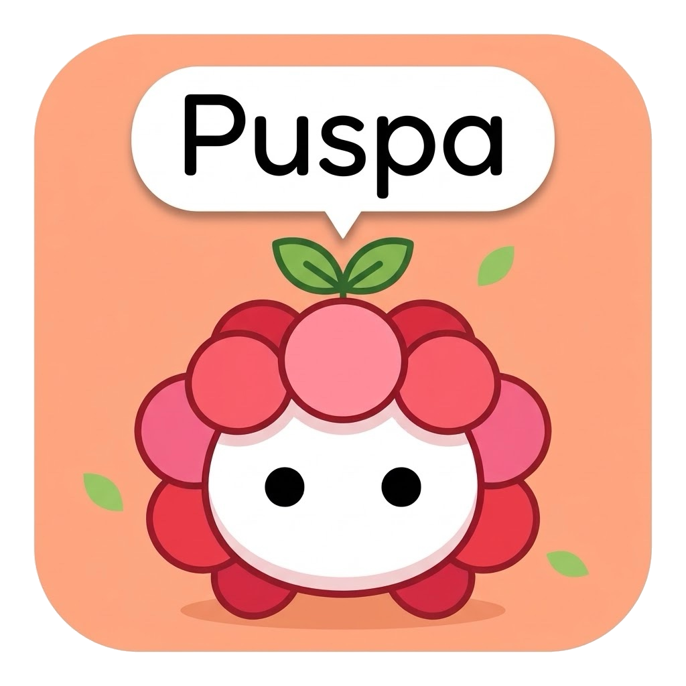
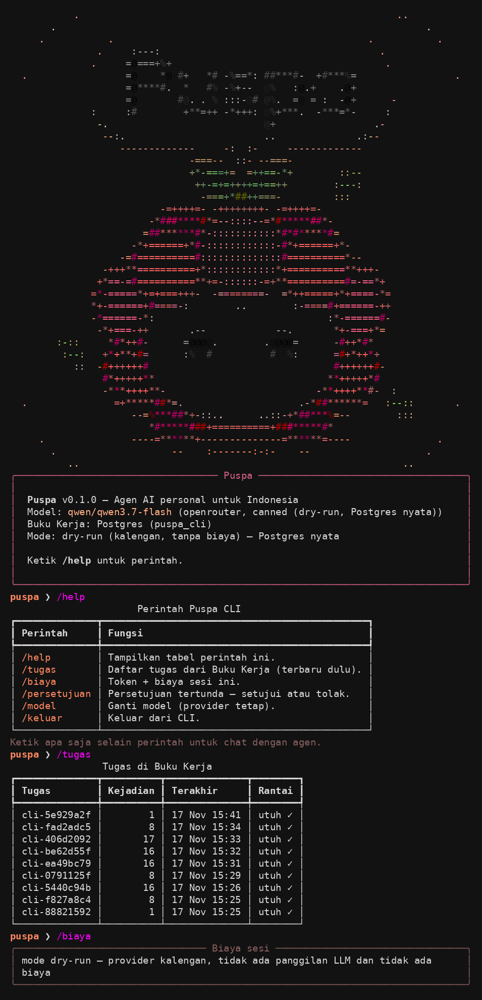
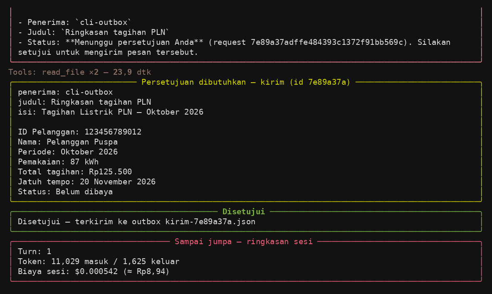
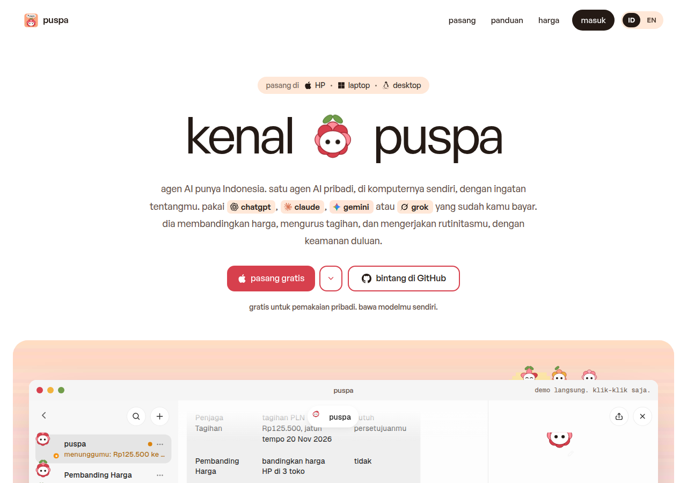
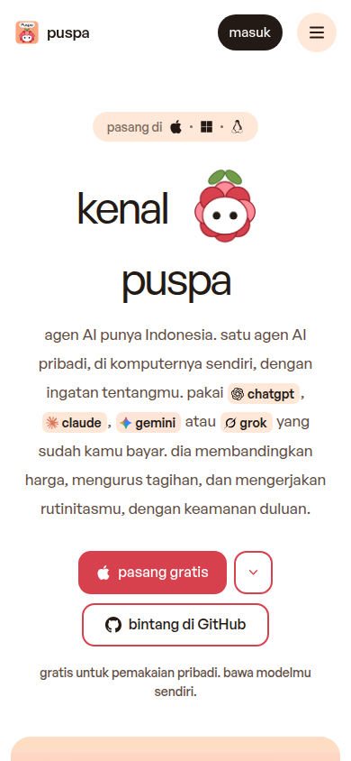

# Puspa: Indonesia's own personal AI agent

<p align="center">
  
</p>

<p align="center"><strong>One personal AI agent, on its own computer, with memory of you. Bring your own model.</strong></p>

Puspa (from Sanskrit *puspa*, "flower") is an Indonesian distribution for open-source
personal agents. It builds on the OpenClaw-compatible skill format (`SKILL.md`,
agentskills.io), so it inherits an ecosystem of 3,000+ community skills, and adds the
Indonesia layer on top: local data, an agentic model fine-tune, security by design, and
hosting. Puspa is not a competitor to OpenClaw. The personal-agent chassis already
exists; Puspa is the Indonesian distribution of it.

The product home is a PWA (progressive web app): chat with your agent, tasks, approvals,
memory, connectors, and skills in one place, installable on phone and desktop.
Telegram and WhatsApp are access channels, not the home.

## Why Puspa exists

1. **Personal agents today are closed, expensive, absent from Indonesia, and your data
   lives in their cloud.** Puspa is open source, priced in rupiah, and your data stays
   on your own computer or server.
2. **Open agent chassis are unsafe by default.** Of 2,857 community skills ever
   checked on ClawHub, 341 turned out dangerous. More than 135,000 agent instances
   were exposed to the internet, and CVE-2026-25253 (CVSS 8.8) showed how one bad
   skill can take over an agent. Puspa builds security first, not as a patch.
3. **No agent carries Indonesia inside it.** Language, behavior, payments, services,
   and local data. Puspa brings Indonesia into the model, the data, and the features,
   in five layers: the model, persona and memory data, data graphs, features, and
   community and docs.

## Security first

Security is the foundation, built before anything else. It is structural (quarantine,
tokens, a single gate), not a prompt filter, because prompt filters can be bypassed.

- **Signed skills.** A skill without a valid signature is rejected.
- **Per-skill permission manifests.** A tool outside a skill's manifest is rejected.
- **Permission tokens that only narrow downward.** Every agent and subagent holds a
  signed token (Ed25519) listing its tools, domains, connectors, budget, and expiry.
  A subagent's token is always a subset of its parent's, and an agent's token is
  always a subset of what you granted. The subset check is done in code, not by the
  model.
- **One gate for all outbound actions.** Send, create an event, prepare a payment,
  delete: everything passes one code gate that checks the token, the spending limit,
  and the approval rules. There is no other path in the code.
- **Spending limit as code, default Rp0.** The agent cannot raise it by itself.
  Nothing is spent or sent without your approval.
- **Approvals bound to exact content.** An approval covers one exact action (the
  recipient and body of a message, the amount and destination of a payment). If the
  content changes after approval, the approval is void and asked again.
- **Append-only audit log.** Everything is written once to the ledger (an
  append-only Postgres table with a per-task hash chain). Chat, the office view,
  audit, evidence, and cost are projections of the same log, so no agent work is
  hidden.
- **Quarantined readers.** Untrusted content (web pages, emails, files) is read only
  by reader subagents that hold no tools and no write access. Their output is strict
  JSON, marked as data, and never placed where an instruction goes. Instructions
  found in web, email, or file content are treated as data, not orders.
- **Fail-closed sandbox.** Each agent runs in its own container, each subagent in its
  own container under it. If the sandbox fails, the agent stops. It never runs on the
  host instead.

**Tested, not claimed:** 8 attack paths must fail to break through, and all 8 do
(see `tests/test_attacks.py` and `tests/test_access.py`): unsigned skill, tool outside
the manifest, injection through web content, reading another agent's memory, a
listing or email injection ordering a send or a payment (the executor ran 0 times),
a subagent calling a tool outside its token, content changed after approval, and one
user reading another user's data through the API.

## What it does

### Compare prices

Nine categories with matchable model numbers: phones, laptops, tablets, smartwatches,
earphones/TWS, TVs, game consoles, cameras, and branded home appliances. The agent
spawns one reader per marketplace (Tokopedia, Shopee, Blibli) working in parallel,
matches listings to a canonical product through the identity graph, and an independent
verifier re-reads every number from its source before it reaches you. You get the
cheapest price with the store and rating, the price at each marketplace, the
difference, links to each listing, and a verdict per price: Verified, Uncertain, or
Cannot be determined. The model never types a meaningful number itself: the renderer
fills numbers from the evidence book. A number without evidence never reaches you.

### Bill autopilot (PPOB)

PLN, PDAM, mobile credit, and data packages. The agent checks the bill, reminds you before the
due date, and prepares the payment. You approve it in your own bank app (safe-pay
mode). The agent never moves money silently and never holds money or payment
credentials.

### Fraud guard

Before you pay, the agent checks the account, number, or link against the fraud-report
network. The scale of the problem (OJK, Oct 2026): IASC received 737,686 reports,
verified 1,471,112 accounts, blocked 743,589 accounts, blocked Rp967.5 billion, and
returned Rp208.9 billion to victims. Only about 7% of funds are saved today, because
reports arrive late. Puspa files the report within minutes, with the evidence package
collected automatically.

### Custom workflows and modules

Describe what you want in plain chat and the agent builds it from 15 certified blocks
(check bill, compare prices, watch prices, search email, read email, create draft,
create event, prepare payment, send notification, ask user, wait for approval,
condition, for each, save memory, save to module table). No new code. The workflow is
dry-run in read-only mode first, then activated with your approval. Triggers: schedule,
bill due date, price drop, manual. A module is a mini-app: UI in the PWA, logic on the
bot's computer, schedule, notifications, and its own data, written as one declarative
manifest and checked by a 5-step manifest gate in code. Three built-in templates:
monthly bills, watch an item's price, weekly bill recap. Two built-in modules use the
same format: Compare Prices and Bills.

### Indonesia inside

QRIS (safe-pay mode), BI-FAST, virtual accounts, e-wallets (GoPay, OVO, DANA,
ShopeePay), PPOB, cross-border QRIS, prayer times and qibla direction, national
holidays and joint leave days, Gojek, Grab, GoFood, local e-commerce, package tracking
(JNE, J&T, SiCepat, AnterAja), regional languages and speech levels, and rainy-season
weather in scheduling.

## Bring your own model (BYOK)

Puspa works with any provider through one generic factory: OpenRouter, OpenAI,
Anthropic, Gemini, Azure OpenAI, Groq, DeepSeek, Together, Ollama/local, and Bedrock.
A new provider is one line of configuration. Your key lives in your encrypted vault;
the agent never sees it. OAuth providers (xAI, GitHub Copilot, OpenAI Codex) need an
interactive login instead.

A real run, end to end, on Qwen 3.7 Flash via OpenRouter: read a bill file, spot an
injection in a second file, attempt a payment (rejected at the Rp0 limit), and send a
summary (held for approval). Cost: $0.00105, about Rp17.

## Screenshots

### The CLI

The command-line version of Puspa, with the same security core (ledger, permission
token, approval gate) and the same BYOK providers. The CLI speaks Indonesian, the
product's first language.



*Dry run: banner, status panel, `/help`, `/tugas` (tasks from the ledger, hash chain
intact), `/biaya` (session cost). No model call, no cost.*



*Live run (Qwen 3.7 Flash via OpenRouter): the agent asks for approval before sending
a PLN bill summary (Rp125,500, due 20 Nov 2026). Approved by a human, sent to the
outbox. Session cost: $0.000542, about Rp8.94.*

### The landing page





*Landing page preview (Indonesian default, with an ID/EN switcher in the nav). The
landing is being reworked; these screenshots are a snapshot of the current design.*

## Pricing (early numbers)

Prices below are early numbers to be validated against real server costs. What does
not change is the shape: free means self-hosted, paid means the server is provided.

| Tier | Price | Includes |
| --- | --- | --- |
| Free | Rp0, forever | Everything. Self-host on your own PC or VPS. No work license. |
| Plus | Rp99,000/month | Everything in Free, plus a cloud server provided (2 vCPU, 4 GB RAM, 20 GB disk), always on. |
| Pro | Rp199,000/month | Everything in Plus, plus a bigger cloud (4 vCPU, 8 GB RAM, 60 GB disk), priority, work license for one person. |
| Team | Rp499,000/month | 2 seats plus a dedicated cloud machine; each extra member Rp99,000/month. |
| Credits | 15 free/month; packs Rp9,000/20, Rp35,000/100, Rp150,000/500, never expire | For heavy compute: video try-on per second, detailed price checks, video clips. Light features need no credits. |

Creating a module costs 5-10 credits (or your own provider bill if you bring your own
key). Using your own module is free. Paid community modules split 70/30 (creator 70,
Puspa 30).

## Build status

Phases 0-4 of the MVP (revision 7, approved 17 Nov 2026) are implemented. The full
test suite passes: **517 tests passing, 4 skipped**, verified 17 Nov 2026 from solo
runs (the 4 skips are live Docker container tests, which need a normal Docker host).

| Phase | What | Tests |
| --- | --- | --- |
| 0 | Security + backbone: ledger, permission tokens, accounts, quarantine, sandbox, chassis integration | 248 passed, 4 skipped |
| 1 | Persona + memory + onboarding | 58 passed |
| 2 | Runtime + PWA + connectors + scheduler | 73 passed |
| 3 | Wedge (price comparison, bills) + moat (identity/price graph, service flow graph, evidence book) | 62 passed |
| 4 | Custom workflows + custom modules | 76 passed |

What is next: user testing with 11 people (the owner plus 10 test users), the
remaining gates (custom workflows and custom modules need test users, an always-on
host, and 7 days of scheduled runs), and the always-on host itself. This is an MVP in
active development, not a finished product. The fraud-report network and the sold-price
ledger are deliberately not in the MVP: they need real volume first.

## Quickstart

```bash
python3 -m venv .venv
.venv/bin/pip install -r requirements.txt
sudo -u postgres psql -c "CREATE ROLE root LOGIN SUPERUSER;" -c "CREATE DATABASE puspa_test OWNER root;"
.venv/bin/python -m puspa.migrations up
.venv/bin/python -m pytest tests -q
```

Needs a local Postgres 16 (database `puspa_test`). The schema setup is idempotent
and safe to re-run: the migration runner applies only pending migrations. On this host, installing the agent chassis needs
`NANOBOT_SKIP_WEBUI_BUILD=1` (the chassis web UI build is not used by the tests).
See `docs/migrations.md` for setup and recovery notes.

## Repository layout

```
puspa/            # one package, one subpackage per domain
  ledger/         # append-only event log, per-task hash chain, 31 event types
  policy/         # permission tokens (Ed25519), signed skills, the single gate
  accounts/       # login, per-device sessions, per-user vault, row level security
  quarantine/     # quarantined reader + prompt-injection scan
  sandbox/        # fail-closed Docker sandbox
  chassis/        # integration with the agent chassis at its extension points
  memory/         # profile, episodic, procedural memory + consolidation
  persona/        # speaking style learned from the user's own messages
  runtime/        # task cycle, handoff contracts, durable execution
  router/         # tiered model router + BYOK provider factory
  connectors/     # Google connectors (Gmail, Drive, Calendar) via OAuth 2.0 + PKCE
  billing/        # bills, credits, spending limits
  graphs/         # identity/price graph, service flow graph, evidence book
  workflow/       # custom workflows: 15 certified blocks, 4 triggers
  modules/        # custom modules: declarative manifests + manifest gate
  auth/ backup/ consent/ evidence/ moat/ onboarding/ pricing/ push/ pwa/
  scheduler/ cassette/
tests/            # 517 tests
docs/             # glossary, contracts, phase status, reuse log
demo/             # BYOK provider factory + mock provider harness
infra/            # Postgres schemas (core, runtime, graphs, workflow)
apps/pwa/         # the PWA: 7 screens (chat, tasks, modules, connectors,
                  # memory, settings, office)
```

The agent chassis is nanobot 0.4.1 (MIT), installed as a pinned pip dependency and
wrapped at its official extension points. No chassis code is changed. Third-party
patterns and licenses are recorded in `NOTICE.md` and `docs/reuse.md`.

## How the pieces fit

- **One log, many projections.** Everything that happens is written once to the
  ledger. Chat, the office view, audit, evidence, cost, and graphs are read from the
  same log and can be rebuilt from it at any time.
- **Numbers without evidence never reach you.** Every meaningful number (price, bill
  amount, due date, difference) points to one evidence record: source URL, time
  taken, text excerpt, reader, and verifier verdict. The model never types a
  meaningful number itself.
- **Permissions only narrow downward.** A subagent never holds more than the agent
  that created it, and an agent never holds more than you granted.
- **Untrusted content never meets tools.** Readers read; executors act on schemas.
  The two never mix.
- **Failure is visible.** A stuck task, an exhausted budget, a changed source, or a
  verifier that disagrees: all of it surfaces to you with a reason. Nothing is
  guessed silently.

## Roadmap (after the MVP)

Fraud-report network and sold-price ledger (once there is real volume), video try-on,
an agentic fine-tune on top of Sahabat-AI (GoTo + Indosat, 8B/9B open weights; the
fine-tune for tool calling does not exist yet), country packs (Malaysia, Philippines,
Vietnam, Thailand, India, Brazil, Mexico), and a module store.

## Docs

- `docs/GLOSSARY.md`: revision 7 terms mapped to English code names
- `docs/contracts.md`: inter-package contracts
- `docs/status-phase-0.md` … `docs/status-phase-4.md`: per-phase status and evidence
- `docs/reuse.md`: what was reused, as a dependency or as a pattern, and its license
- `docs/nanobot-inventory.md`: inventory of the chassis package
- `CONTRIBUTING.md`: how to contribute, including signing the CLA
- `CLA.md`: the Contributor License Agreement (lightweight, no copyright assignment)

## License

Puspa's own code is open source; the license file is not yet in this repo and will be
added. Third-party licenses and attribution live in `NOTICE.md`.

---

Built by Muhammad Mirza Kurniawan ([@mirzasnowy](https://github.com/mirzasnowy)).
Puspa is the main project: an Indonesian distribution for open-source personal agents.
